# BlueEdit

A fast console text editor for writing, mathematics and code, on Windows and Linux.

- **Writing**: Markdown with a live preview (markup hidden except on the caret's line) and a reading mode; tables
  aligned, paragraphs reformatted to a margin.
- **Mathematics**: LaTeX made readable — `$…$` as Unicode, display formulas laid out over several rows: fractions,
  roots, limits, integrals, aligned rows, matrices; typeset as pictures in terminals that show Sixel graphics
  (Windows Terminal 1.22+), with the optional module ([docs/formula-pictures.md](docs/formula-pictures.md)). Boxes
  instead of symbols: the terminal's font lacks them ([docs/terminal-fonts.md](docs/terminal-fonts.md)). A formula
  that would not typeset (an unclosed brace, `\left` without `\right`, `\frac` with one argument) is underlined as
  an error, without any model ([docs/proofing.md](docs/proofing.md#formula-errors)).
- **Checking**: spelling with the dictionaries already on the computer; grammar and style through the checkers you
  choose to install (below). Typing never waits for them.
- **Code**: syntax highlighting, completion, errors and definitions from language servers, line numbers (Alt+G);
  indent after `:` and `{`, line comments (Ctrl+/), moving lines (Alt+↑/↓), the bracket pair marked.
- **Editing**: tabs, column blocks, soft wrap; a file changed by another program is reloaded.

A key reaches the screen in about 5 ms. One self-contained file, no installer: `be.exe` on Windows, `be` on
Linux (the command is `be`, as `mc` is Midnight Commander) ([docs/linux.md](docs/linux.md)). `be.exe` is not
signed, so the first start of a downloaded copy may meet a warning: "Windows protected your PC" — **More info > Run
anyway**; "The publisher could not be verified" — **Run**.

## Screenshots

**Markdown live preview** — markup is hidden except on the line with the caret; spelling mistakes are underlined;
`$...$` formulas are shown as Unicode.

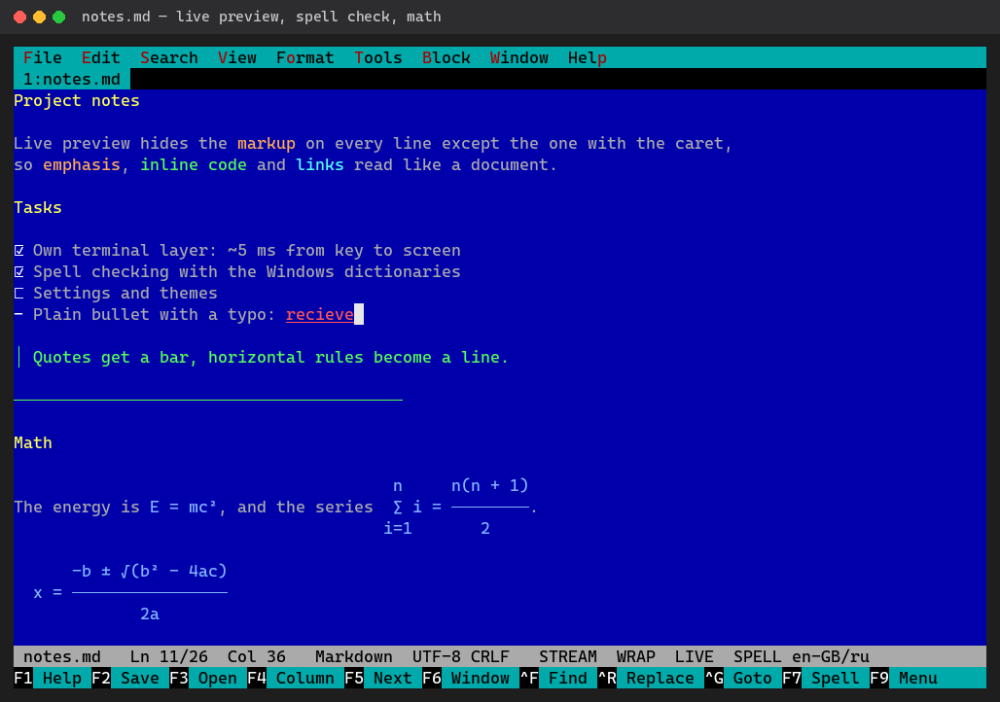

| | |
|---|---|
| 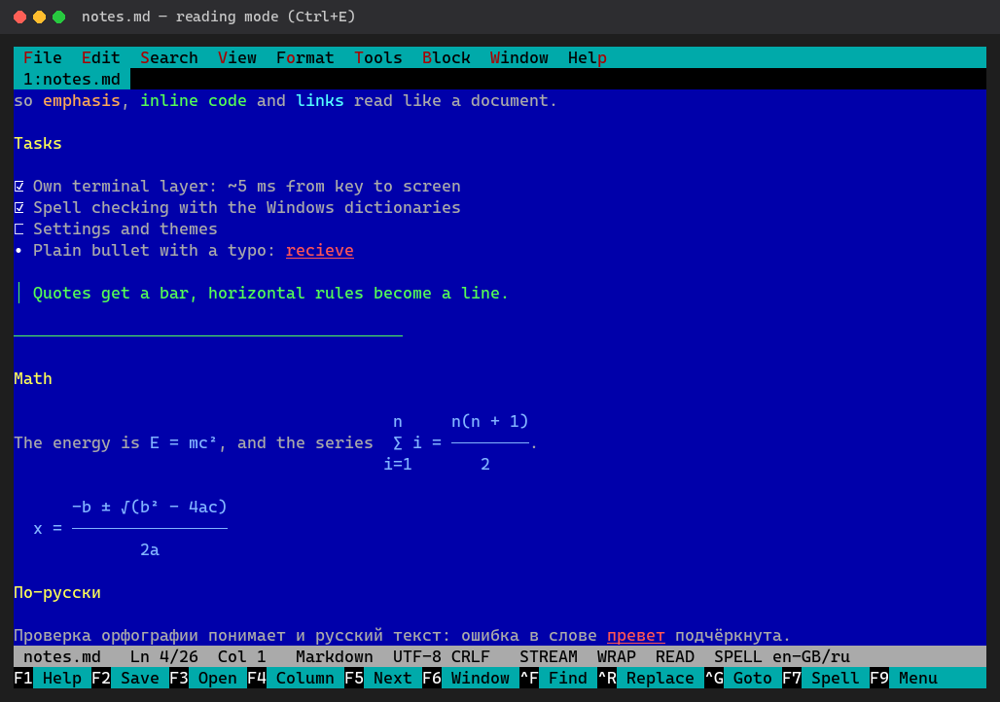 **Reading mode** (Ctrl+E) | 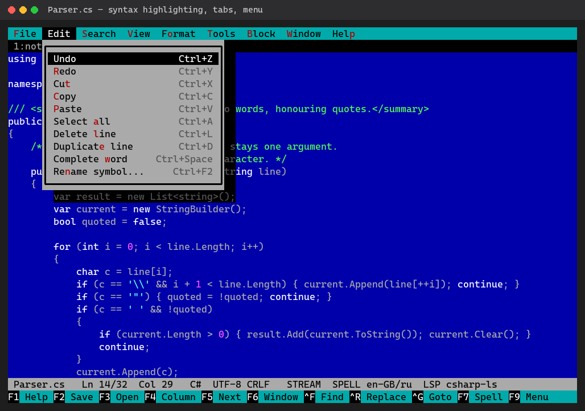 **Syntax highlighting, tabs, menus** |
| 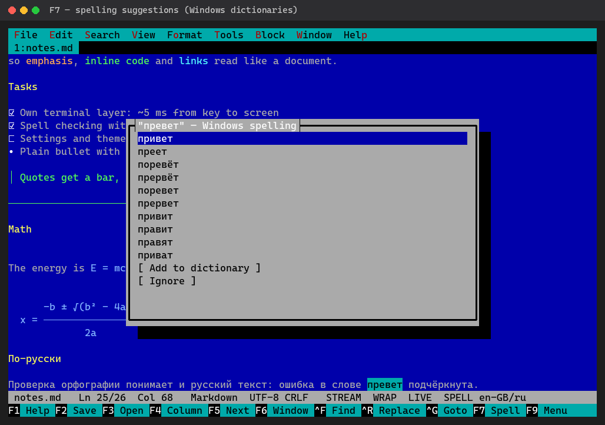 **F7 spelling suggestions** (from the dictionaries installed in Windows) | 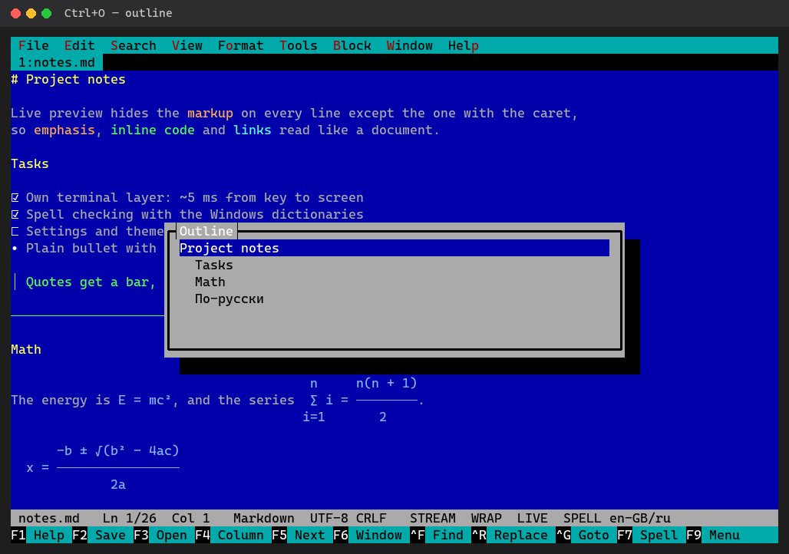 **Ctrl+O outline** |
| 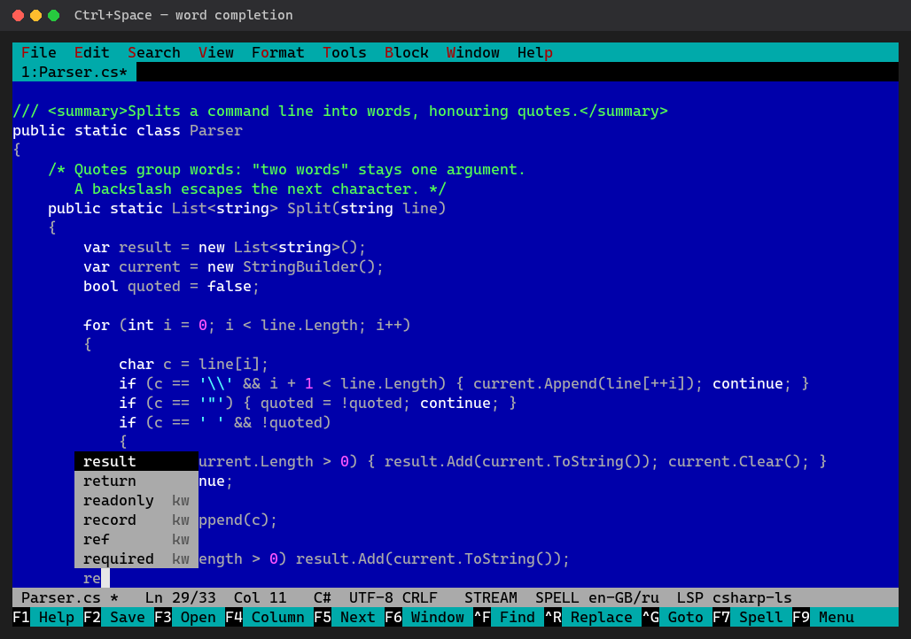 **Ctrl+Space word completion** (words of the open documents, then keywords) | 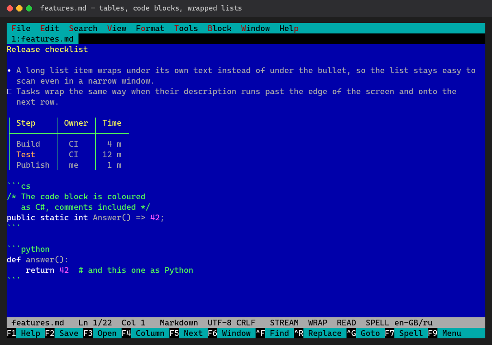 **Tables, code blocks by language, wrapped lists** |
| 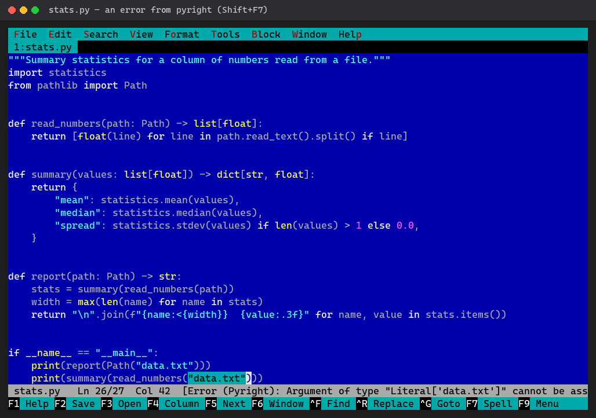 **Errors from a language server** (pyright here; Shift+F7 goes to the next) | 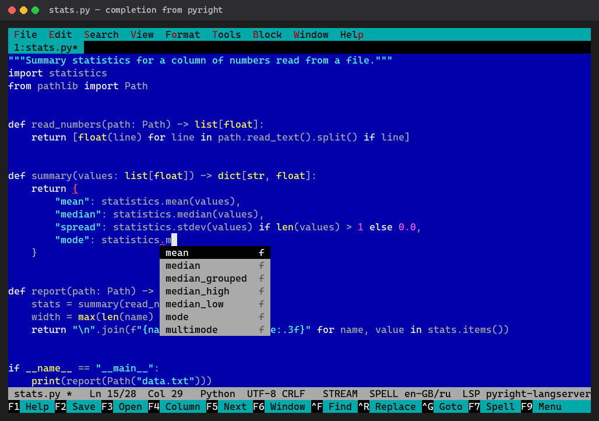 **The server's members after a dot** |
| 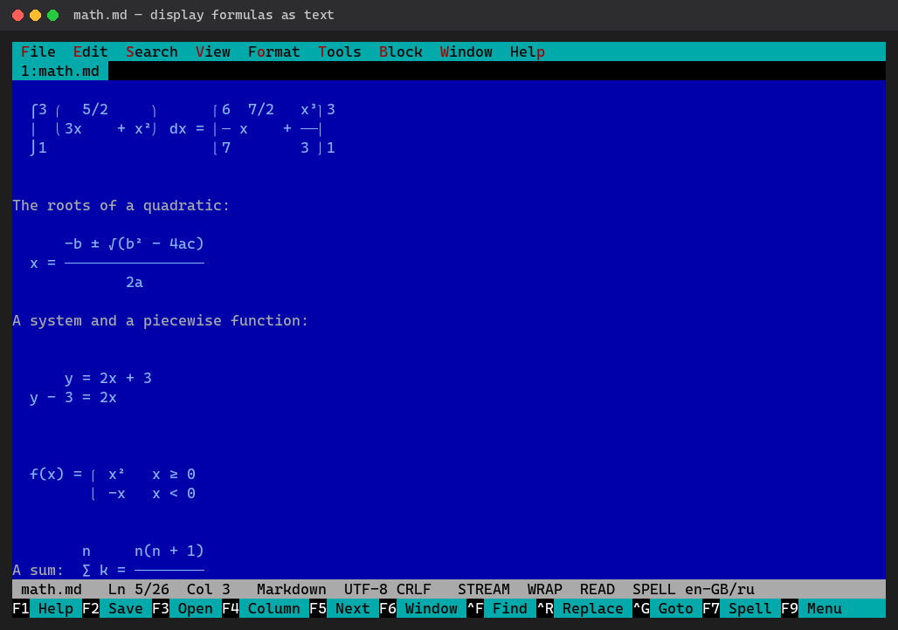 **Display formulas laid out as text** over several rows | 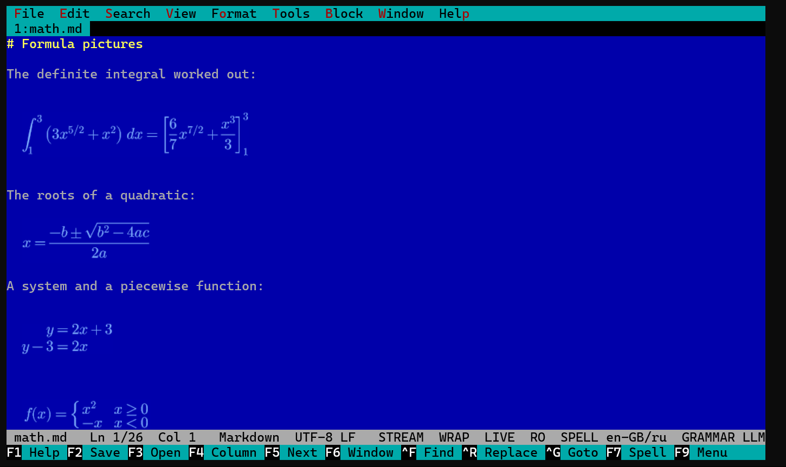 **The same formulas as typeset pictures** in Windows Terminal ([docs/formula-pictures.md](docs/formula-pictures.md)) |

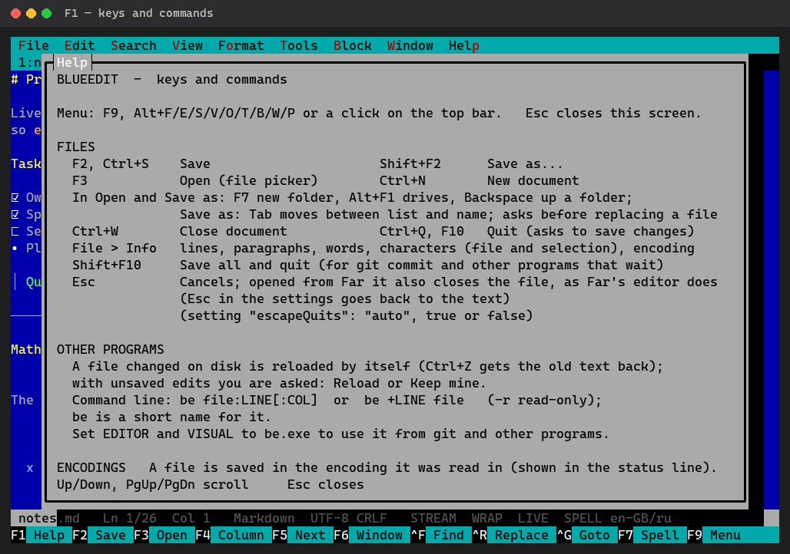

The screenshots are generated, not hand-made: `python tools/screenshots/make_screenshots.py` runs the published
editor in a pseudo-console, plays the scenarios and renders the screen. Rerun it after UI changes. The formula
pictures are the one exception: they are Sixel graphics, which the emulated screen does not draw, so that one is a
capture of a real Windows Terminal window.

## Build and run

    dotnet build
    dotnet run -- file.md
    dotnet publish -c Release -r win-x64 --self-contained -p:PublishSingleFile=true -o publish
    .\tasks.ps1 publish-linux       # the Linux build and its tar.gz in publish-linux\ (docs/linux.md)

Command line: `be [-r] [+LINE] file[:LINE[:COL]]...`  (`-r` read-only, `+N` open at line N,
`file:12:5` as compilers, grep and other tools print locations; `--version` and `--help` print and exit).
Press **F1** inside the editor for the full key list. The first start shows a short welcome: the keys to begin
with, the spelling that works already, the way to grammar checking and the interface language (once; Esc begins).

**Syntax highlighting** (by extension or file name, the same in Markdown code blocks): C#, C/C++, Java, JavaScript /
TypeScript, Go, Rust, Python, PowerShell, Batch, shell (`.sh`, `.bash`, `.zsh`, `.bashrc`), SQL, Pascal, JSON, YAML,
HTML/XML, LaTeX, Markdown, INI/TOML, Makefile, Dockerfile. A script without an extension is recognised by its `#!`
line (`#!/bin/bash`, `#!/usr/bin/env python3`).

## Search

- **Ctrl+F** find, **F5 / Shift+F5** next / previous; options in the dialog: **Alt+C** match case, **Alt+W** whole
  word (works for Cyrillic), **Alt+R** regular expression (.NET syntax).
- **Ctrl+R** replace: each match is selected and the status line asks *Y* yes, *N* no, *A* all the rest, *Esc*
  stop. With a regular expression `$1`, `$2` insert the groups. "All" is one undo step.
- **Alt+F7** find in folder (as in Far): every file under a folder, with masks like `*.md;*.cs`; skips `.git`,
  `bin`, `obj`, `node_modules` and binary files; reads cp1251/cp866 files correctly. Enter on a result opens the
  file at that line; *Search → Folder results* shows the list again.
- **Tab / Shift+Tab** on a selection of several lines indents / unindents them.
- Hotkeys and the Y/N/A answers also work while the Russian keyboard layout is active.

## Word completion

**Ctrl+Space** after the start of a word: words of all open documents (nearest to the caret first) and the keywords of
the file's language (marked `kw`). One candidate goes in at once; otherwise a list opens under the word. Typing
narrows it, Up/Down choose, Enter or Tab take the word, Esc closes, one Ctrl+Z undoes it.

## Paragraphs

**Alt+R** (Format → Reformat paragraph) joins the paragraph's lines and breaks them again at words to the right
margin (`rightMargin`, 78); with a selection, each paragraph in it on its own. List items and quotes keep their marks,
the next lines hang under the text; an inline formula `$…$` or code is never split. **Format → Align** left, right,
centre or justify (justify reformats and stretches the gaps); right, centre and justify only in plain text — in
Markdown the extra spaces vanish when shown. **Format → Auto-wrap at the margin** wraps while typing (`AUTOWRAP` in the
status line). None of it applies to code. Soft wrap (Alt+Z) is different: it only shows long lines wrapped, the file
keeps them whole.

## With git and other programs

- A file changed on disk by another program is **reloaded automatically** when it has no unsaved edits
  (Ctrl+Z brings back the previous text). With unsaved edits the editor asks: *Reload* (your edits are one
  Ctrl+Z away) or *Keep mine*. Saving over a file that changed since it was opened asks first.
- **Shift+F10** saves all documents and exits — the way to finish when a program opened the editor and waits.
- To make it the editor that `git commit` and other programs open (coding assistants too, such as Claude Code with
  Ctrl+G), set the usual variables (`VISUAL` wins where a program reads both):

      setx EDITOR "C:\path\to\be.exe"
      setx VISUAL "C:\path\to\be.exe"

  To start it as `be` in any console, wherever the zip was unpacked: **Tools → Command be in any console…** puts
  its folder in your PATH (the user's own, no administrator rights) or takes it out again.

  New terminals pick them up; `git config --global core.editor` works for git alone.

## Saving and recovery

- A save writes a temporary file beside the old one and then puts it in its place, so a power cut or a full disk
  cannot leave half a file. A file that cannot be written (open in Word, read-only, no permission) says so in a
  *Not saved* dialog; the text stays in the editor.
- **Recovery**: every 10 seconds (`autoRecoverSeconds`) the documents with unsaved edits are copied to
  `%LOCALAPPDATA%\BlueEdit\recovery` (on Linux `~/.local/share/BlueEdit/recovery`), never over the files. A normal
  exit removes the copies. If the editor ended any other way (killed, an error, the power), the next start offers
  the text back: *Recover* opens it as unsaved documents, *Discard* deletes the copies, *Later* asks next time.

## Encodings

A file is saved back exactly as it was read: same encoding, same line endings, same BOM.
On opening, a BOM decides; valid UTF-8 is UTF-8; anything else is Windows-1251 or DOS 866 (cp866), whichever
decoding reads like Russian text (DOS pseudographics count for cp866). The status line shows the result.

- **File → Reopen with encoding…** — the text is garbled: read the same bytes again as UTF-8, UTF-16, cp1251,
  cp866, KOI8-R, cp1252 or cp437.
- **File → Convert encoding…** — the text is right, save it in another encoding; if some characters cannot be
  stored there, it says how many and can jump to the first one before anything changes.
- **File → Line endings** — switch between CRLF and LF.

New files are UTF-8 without BOM.

## Language servers

Errors and warnings in code come from language servers, as in VS Code: pyright for Python, csharp-ls for C#, TypeScript's own
server for JavaScript and TypeScript, any LSP server you name for other languages. Underlined as you type; **Shift+F7** goes to the next, **F7** offers the server's fixes (`using System.Text;`…) or shows the message;
the status line shows the server and counts (`LSP pyright-langserver 2E 1W`). After a dot the server's members are
listed (`os.` → `path`…), marked with their kind (`m`, `fld`, `cls`…); Ctrl+Space asks the server too. **F12** goes
to a definition (**Shift+F12** back), **Alt+F1** shows what the server knows about a symbol, **Ctrl+F12** formats the
file (by the server's formatter, or ruff/black for Python), **Ctrl+F2** renames a symbol in every file, **Alt+F12** lists where it is used, **Ctrl+O** outlines the file, and while typing a call the
status line shows its parameters. Each server is installed once; a server that is not there is simply not used.

**Installing them: Tools → Code tools.** The editor lists pyright, ruff, csharp-ls and TypeScript — found where, or what
installing takes — and Enter installs one (or all that are missing) into its own folder: no administrator, no system
packages, Node.js and the .NET SDK brought along when needed, everything checked against its published checksum. The same
without the screen, for a server over SSH: `be --install-tools`. Details: [docs/lsp.md](docs/lsp.md).

| Other ways | How |
|---|---|
| Windows | `tools\lsp-setup\install.ps1 -All` (system-wide Node.js and .NET SDK through winget, with administrator approval) |
| Ubuntu, Debian, WSL | `tools/lsp-setup/install.sh --all` (`nodejs npm` and `dotnet-sdk-10.0` through apt, with sudo) |

Details: [docs/lsp.md](docs/lsp.md) (in Russian: [docs/lsp.ru.md](docs/lsp.ru.md)).

## Settings

**Tools → Settings…** shows the everyday settings as a list (colours, Markdown view, formula pictures, spelling, wrapping, margins, Esc, keys in any layout on Windows): Space or ← → changes one, Enter saves and applies them at once. Its last row, **Edit settings.json…**, opens the file with all the settings and their comments; saving it (F2) applies the changes, Esc goes back to the text. The list writes into the same file, keeping your comments.
The file lives in `%APPDATA%\blueedit\` and explains every option in comments:

| option | default | meaning |
|---|---|---|
| `uiLanguage` | `"auto"` | the interface's language: `"auto"` (the system's), `"en"`, `"ru"` (menus, dialogs, messages and F1 help). A file `lang/<code>.json` in this folder, English string → translation, adds a language or changes strings; a new one starts from [lang/template](lang/template/README.md) |
| `theme` | `"dos-blue"` | `"dos-blue"`, `"dark"` or `"light"` (also in **View → Theme**) |
| `tabSize` | `4` | spaces inserted by the Tab key |
| `rightMargin` | `78` | the right margin of **Format → Reformat paragraph** (Alt+R), Align and auto-wrap |
| `wordCount` | `false` | the number of words in the status line (Markdown: without markup, formulas and code); **File → Info** has all the counts |
| `autoWrap` | `false` | wrap while typing: a word typed past the right margin goes to a new line (text and Markdown; **Format → Auto-wrap**) |
| `autoRecoverSeconds` | `10` | how often documents with unsaved edits are copied for recovery after the editor ended without saving ([Saving and recovery](#saving-and-recovery)); `0`: no copies |
| `autoIndent` | `true` | Enter keeps the indentation of the line above, one step deeper after a line that opens a block (Python's `:`, `{` `[` `(` in C#, JavaScript and other brace languages; between `{` and `}` the closer goes to its own line) |
| `completeWhileTyping` | `"code"` | the completion list (Ctrl+Space) opens by itself after three letters of a word that has candidates: `"code"` in code files (not in strings or comments), `"always"`, `"off"`. **Tab** takes the word; **Enter** takes it only after choosing with the arrows, otherwise starts a new line |
| `autoClose` | `"code"` | brackets and quotes in pairs: `(` adds `)`, typing `)` steps over it, Backspace removes an empty pair, an opener over a selection wraps it. `"code"` in code files (not inside strings or comments), `"always"` also in prose (no apostrophes), `"off"` |
| `spellCheck`, `spellLanguages` | `true`, `"auto"` | Windows spell checking; `"auto"` = the system's languages (added in Windows; on Linux the locale's, `LANG`), or a list like `["ru-RU", "en-GB"]` (also **Tools → Spelling languages…**) |
| `spellProvider` | `"windows"` | `"windows"` (instant), `"office"`: Microsoft Word's dictionaries, asked in the background in a hidden Word, or `"hunspell"`: LibreOffice dictionaries (always on Linux and macOS; also **Tools → Spelling provider…**) |
| `grammar` | `"off"` | grammar checkers to use together: `"languagetool"`, `"llm"`, `"edge"`, `"harper"` or a list like `["languagetool", "llm"]` (see below) |
| `languageToolDir`, `llmDir`, `llmModel` | `""` | where they are installed; `llmModel` picks the `.gguf` model (empty: the best one present; `"server"`: the model server below) |
| `llmServer`, `llmServerModel`, `llmApiKey` | `""` | a model server at an address (Ollama, LM Studio, llama-server elsewhere, a cloud API): its address, the model's name there, a key, `"env:NAME"` or `"file:PATH"`; chosen in **Tools → Grammar model**, or used when llama.cpp here is missing or does not start (docs/proofing.md) |
| `edgePath` | `""` | the `msedge.exe` whose built-in proofreader is used (empty: Edge Canary) |
| `languageToolDisabledRules`, `languageToolDisabledCategories`, `languageToolEnabledRules`, `languageToolLevel` | spacing rules and `TYPOS` off, `"default"` | LanguageTool's rules: switched off, switched on, `"default"` or `"picky"` (docs/proofing.md) |
| `ignoredRules` | `[]` | findings never shown, from any checker (F7 → Never show this; **Tools → Ignored rules…**) |
| `escapeQuits` | `"auto"` | Esc closes the file (and the editor with the last one) once there is nothing to cancel, as in Far's editor: `"auto"` only when Far Manager opened it (F4), `true` always, `false` never |
| `keyEvents` | `true` | Shortcuts with punctuation and digits (Ctrl+/, Ctrl+1) work in any keyboard layout: on Windows keys are read as key events, on Linux and macOS through the kitty keyboard protocol where the terminal has it (Windows Terminal 1.25 over SSH does); **Tools → Settings… → Keys in any layout**; `false` reads keys as text, as before ([#184](docs/tech/tui.md#key-events-on-windows)) |
| `wrapProse`, `wrapCode` | `true`, `false` | soft wrap for Markdown/LaTeX/text and for code |
| `lineNumbers` | `false` | line numbers at the left, for every file (Alt+G turns them on or off and saves this) |
| `markdownView` | `"live"` | how Markdown opens: `"source"`, `"live"` or `"reading"` |
| `formulaSymbols` | `"full"` | `"basic"`: formulas as text without the characters most fonts lack (`ₙ`; `⩽` as `≤`), for a terminal that shows boxes for them (docs/terminal-fonts.md) |
| `latexCheck` | `true` | formulas that would not typeset underlined as errors in Markdown and LaTeX files; Shift+F7 goes to them, F7 explains |
| `latexStyle` | `true` | with `latexCheck`: rules of writing in formulas as warnings (`cos` without `\`, `2*3`, `<=`, `5 cm` in italics); F7 puts in the fix or never shows that rule again |
| `formulaImages` | `true` | display formulas as typeset pictures where the terminal shows Sixel graphics and the mathimages module is installed (**View → Formula pictures**; docs/formula-pictures.md) |
| `colors` | `{}` | overrides, e.g. `{ "keyword": "#ffcc00", "background": "#101820" }` |
| `fontSetup`, `font`, `fontSize` | `"auto"`, `"Cascadia Mono"`, `12` | terminal font, see below |

A broken value is reported in the status line and the default is used instead.

### Spelling

**Ctrl+F7** asks the local language model for a better wording of the paragraph (less officialese, wordiness and
repetition; optionally informal words in academic writing); you tick which changes to take — **Tools → Style options…** sets what it looks for. **Shift+F7** goes to the next spelling or grammar problem and selects it, so **F7** fixes it. Each finding names
its source: the F7 title and options say "Windows spelling", "LanguageTool" or the model's name, and the status line
after Shift+F7 reads "Spelling (Windows): …" or "Grammar (LanguageTool): …". Web addresses, e-mail and paths are not
spell-checked. A word typed partly in the other keyboard layout ("пpивет" with a Latin p) is always marked, whatever
the dictionary says; F7 offers it in one alphabet.

Words added with **F7 → Add to dictionary** go to `dictionary.txt` next to `settings.json` (one per line, editable),
so they stay whichever provider is used.

A step-by-step guide (setup, keys, choosing checkers, a test text): [docs/proofing.md](docs/proofing.md),
in Russian [docs/proofing.ru.md](docs/proofing.ru.md). Installing the checkers — **Tools → Set up grammar
checking…** (a model here with its size and licence, a model server at an address, LanguageTool or Harper; the editor
installs it and turns it on; **Tools → Get spelling dictionaries…** for Hunspell's on Linux and macOS),
`be --install-proofing` in a shell, one script
(`tools\proofing-setup\install.ps1 -All`) or by hand: [docs/proofing-setup.md](docs/proofing-setup.md).
How it is built and what was found researching Edge, Chrome and Word: [docs/tech](docs/tech).

### Grammar

Grammar checking is optional and uses external programs you install yourself, running on your computer — nothing
leaves it. **Tools → Grammar checking…** turns one of these on for Markdown, LaTeX and plain text (its last line, **Several
at once**, allows more, their findings shown together); findings are underlined in their own colour, and **F7** on
one shows the explanation and the fixes. Each paragraph is checked in its own language among your spelling languages:
by its letters, and languages with the same letters (English and German) by fastText's language identification model,
built in (docs/proofing.md, "The language of a paragraph"). A model finds the most; LanguageTool and Harper are for a
computer without a GPU (docs/proofing.md, "Which to choose"):

- **LanguageTool** — the free, open-source edition of [LanguageTool](https://languagetool.org) (LGPL) as a local
  server (not its commercial cloud service). Rule-based, explains every finding, many languages; good at word pairs
  like "одеть/надеть". Needs, in `%LOCALAPPDATA%\BlueEdit` (or `languageToolDir`):

      jre\            Java 21 JRE, e.g. the Eclipse Temurin zip from adoptium.net
      languagetool\   LanguageTool-stable.zip from languagetool.org

  0.7–1 GB of memory while it runs (`languageToolMemory`, docs/proofing.md).
- **Language model** — an open model in [llama.cpp](https://github.com/ggml-org/llama.cpp)'s server, used as a
  proofreader the way Edge's built-in one works: the model returns the corrected text (plus short explanations),
  the editor finds what changed by comparing the texts, and ignores a paragraph the model rewrote instead of
  correcting. Catches agreement and punctuation ("Мы был", "сказал, что", "results was") and suggests the right fix.
  Needs, in `%LOCALAPPDATA%\BlueEdit\llm` (or `llmDir`):

      bin\            llama.cpp for Windows (the CUDA or Vulkan zip from its GitHub releases)
      models\         a .gguf model; tried: YandexGPT 5 Lite 8B (best at Russian), Gemma 3 12B, Qwen3, Gemma 3 4B, Phi-4-mini

  `llmModel` (or **Tools → Grammar model…**) picks one; empty takes the best one present. Answers in 0.2–1 s per paragraph on a mid-range GPU.
- **Edge** (experimental) — Microsoft Edge's built-in on-device proofreader, English only (American spelling). Not
  officially on yet: the editor starts a hidden Edge Canary with a profile of its own and the hidden switches that
  turn it on, and drives it over the DevTools protocol. Needs [Edge Canary](https://www.microsoft.com/edge/download/insider)
  (or `edgePath`); Edge downloads its model (~1.2 GB) on first use. An Edge update may break it.
- **Chrome** — Chrome's built-in proofreader (a small model, English only), through a hidden Chrome with a profile of
  its own, like Edge. Needs its flags on in your Chrome (docs/proofing-setup.md).
- **Chrome model** — the same model without Chrome, in Google's LiteRT-LM (`install.ps1 -ChromeModel`, Python): no
  browser, no GPU; the model file is taken from your Chrome.
- **Harper** — [Harper](https://github.com/Automattic/harper)'s rules for English (open source, no model, no GPU),
  in the dialect of the text's language: British for `en-GB`. Answers in tens of milliseconds. Needs `harper-ls` from
  its releases in `%LOCALAPPDATA%\BlueEdit\harper` or on PATH.

They start on first use (a few seconds) and stop with the editor — also when the editor is killed. Paragraphs are
sent once they have not been edited for a moment; code, code blocks and tables are not checked; markup (in LaTeX its commands) is hidden
from them. Spelling stays with the spelling provider.

### Terminal font

A console program cannot change its font — the terminal draws the text. With `"fontSetup": "auto"` and when
running in Windows Terminal, BlueEdit keeps its **own profile "BlueEdit"** there with `font`, `fontSize` and
the theme colours. It is a Windows Terminal *fragment*
(`%LOCALAPPDATA%\Microsoft\Windows Terminal\Fragments\blueedit\blueedit.json`): your `settings.json` and
other profiles are never edited. Restart Windows Terminal and pick "BlueEdit" from the ˅ menu.
**Tools → Terminal font…** installs, updates or removes the profile. With `"fontSetup": "hint"` nothing is
written and the same menu item explains how to set the font by hand. On Linux and macOS there is no profile: the
menu item says to set the font in the terminal's own settings.

## Checks and routine tasks

    .\tasks.ps1 help      # every routine operation (or: make help)
    .\tasks.ps1 check     # build with analyzers (warnings are errors) + unit tests, ~30 s
    .\tasks.ps1 test-all  # also publishes and runs all UI regression tests (~5 min)
    .\tasks.ps1 ui test_lsp.py    # some UI tests on a fresh build

UI tests drive the real executable in a pseudo-console. One-time setup: `pip install -r tests/ui/requirements.txt`.
Every pull request is checked by GitHub Actions ([docs/ci.md](docs/ci.md)). How to work on the code, the rules and
known pitfalls: [CONTRIBUTING.md](CONTRIBUTING.md). Licence: MIT ([LICENSE](LICENSE)); parts by others:
[THIRD-PARTY-NOTICES.md](THIRD-PARTY-NOTICES.md).

## Layout

- `src/BlueEdit`: the editor (document model, highlighting, Markdown live preview, LaTeX, proofing); `BlueEdit.csproj`
  in the root builds it.
- `src/Tui`: the terminal layer (input parsing, screen buffer, menu bar, dialogs), Windows and Unix; why it exists and
  how it works: [docs/tech/tui.md](docs/tech/tui.md).
- `tests/BlueEdit.Tests`, `tests/Tui.Tests`: unit tests. `tests/ui`: tests that drive the real executables.
- `tools/TuiProbe`: tiny app on the terminal layer, used by the tests to check key decoding and latency.

## Status

Work in progress.
