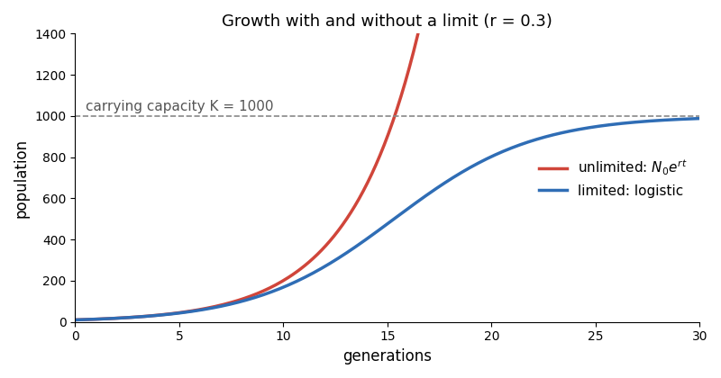

# The struggle for existence

Darwin took the argument from Malthus: every species produces more young than can survive. Even a slow breeder, **unchecked**, would fill the world in a few centuries.

## Growth with a limit

Without a limit a population grows geometrically, $N(t) = N_0 e^{rt}$. Food and space set a ceiling $K$, and growth slows as the population nears it:

$$
N(t) = \frac{K}{1 + \left(\frac{K}{N_0} - 1\right) e^{-rt}}
$$

The two curves agree at first; the gap between them is the young that die. Which of them survive is not chance alone: a slight advantage is inherited.

## Divergence of character

Darwin's only figure in the book: species A to L of one genus, a thousand generations between the lines. The varieties that differ most from their parents spread into the most places, and over time become new species.

![[diagram.jpg]]

> "From so simple a beginning endless forms most beautiful and most wonderful have been, and are being, evolved." — Darwin, *On the Origin of Species*

Next week: variation under domestication.
